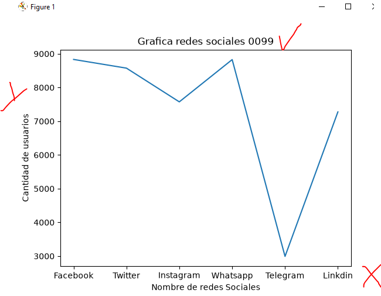
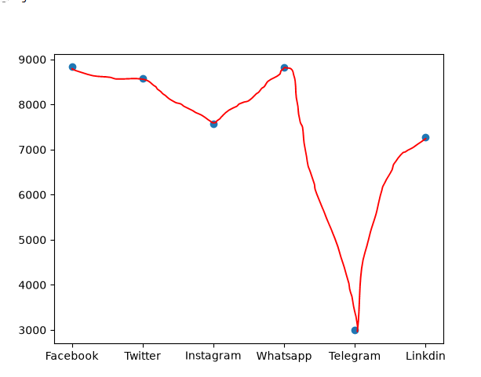
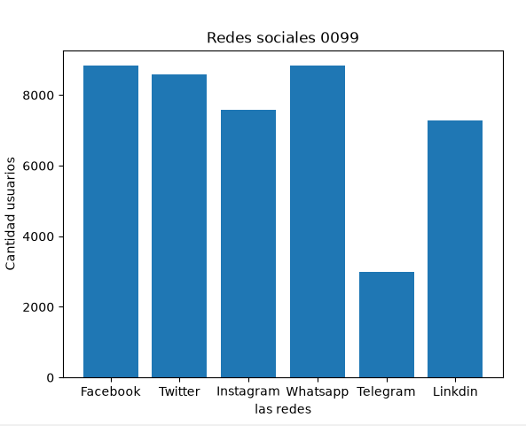
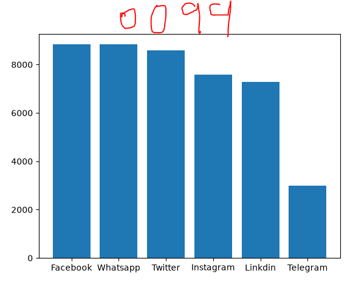
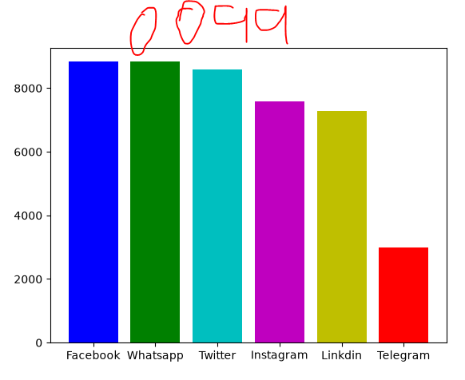
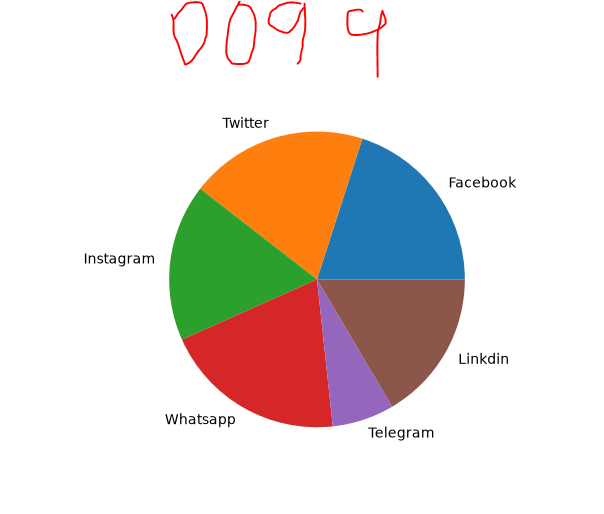

## dataframe o marco de datos pandas

## redes sociales a nivel mundial 
 

## grafica lineal de redes sociales 

## grafica punto de redes sociales 

## grafica de barras de redes sociales 

## grafica de barras del grande al pequeño  Descendente

## coloreando la grafica

## grafica de pastel

